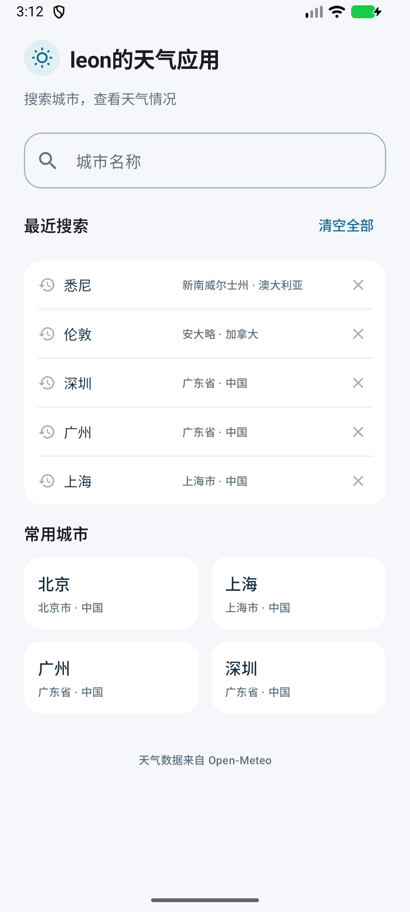
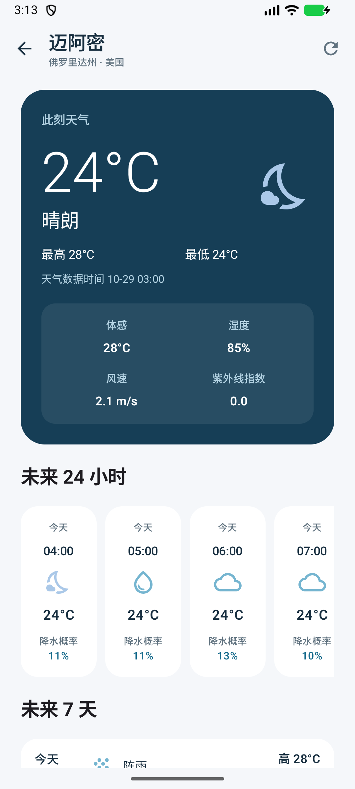
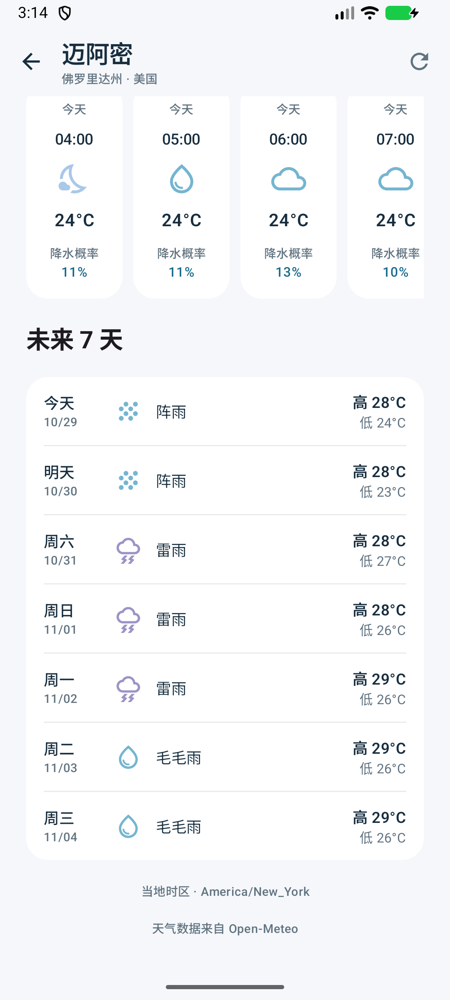

# leon的天气应用

使用 Kotlin + Jetpack Compose 实现的 Android 天气应用，天气与地点搜索由 Open-Meteo 提供，无需 API Key。

## 功能

- 中英文城市搜索、候选确认、常用城市快捷入口。
- 最近五个城市的本地历史记录，支持单条删除和一键清空。
- 当前天气、今日高低温、体感温度、湿度、风速和当前小时紫外线指数。
- 未来 24 小时与七天预报，按城市当地时间展示。
- 加载、空结果、错误与重试；刷新失败保留旧数据并标明天气数据时间。
- 详情页回到前台时，数据已满 15 分钟或城市当地日期变化则自动刷新；跨日更新日期标签并移除已过去的预报项。

## 运行

Android 8.0（API 26）及以上；构建需要 Android SDK 36、Build Tools 36.0.0，以及兼容的 JDK 17 或更高版本。

使用 Android Studio 打开项目根目录，配置 Android SDK，完成 Gradle 同步后运行 `app`。

命令行可执行 `./gradlew :app:assembleDebug`，APK 输出至 `app/build/outputs/apk/debug/app-debug.apk`。

## 架构

单模块、构造函数注入和手动依赖容器，按职责分包，避免为小型应用增加不必要的层级。

```text
ui/                 Compose 页面、ViewModel、状态与导航
model/              城市与天气模型
data/remote/        Retrofit API 与 DTO
data/mapper/        数据校验、时间与天气代码转换
data/repository/    网络访问、本地历史记录与错误分类
di/                 依赖组装
```

- ViewModel 通过 StateFlow 暴露页面状态；Repository 接口便于替换数据来源及测试。
- 搜索采用 300ms 防抖、协程取消和请求版本校验，防止旧响应覆盖新结果；刷新合并进行中的请求。
- 历史记录使用 Preferences DataStore 原子更新；天气仅保留在页面内存中，未实现磁盘缓存。
- 使用可注入的 Clock 判断数据过期和城市当地跨日，测试无需等待真实时间。
- 小时预报按实际时间点转换；每日预报按接口固定的 `utc_offset_seconds` 还原日期，避免夏令时切换丢失一天。缺失数值显示“—”。

主要依赖：Compose、Lifecycle、Navigation Compose、Coroutines、Retrofit、OkHttp、Kotlin Serialization、DataStore；版本统一在 `gradle/libs.versions.toml` 管理。

## 验证

```bash
./gradlew :app:testDebugUnitTest :app:lintDebug :app:assembleDebug
# 连接测试设备后运行界面测试
./gradlew :app:connectedDebugAndroidTest
```

已通过 52 个单元测试、14 个 Compose 界面测试，Debug 构建成功，Lint 无错误。覆盖搜索竞争、历史持久化、刷新过期策略、跨日与夏令时及主要页面流程。设备测试使用 API 37 模拟器。

搜索依赖服务端匹配。联调时，接口查询“厦门”会返回空结果，而“厦门市”可返回结果，因此应用在中文查询无结果时，会自动补查一次“市”后缀变体。不保证任意子串或错别字匹配。

## 数据来源

[Open-Meteo 地点搜索](https://open-meteo.com/en/docs/geocoding-api) · [天气预报](https://open-meteo.com/en/docs)。天气数据遵循 [CC BY 4.0](https://creativecommons.org/licenses/by/4.0/)；应用进行了中文映射、数值舍入、时间转换和预报范围筛选。

## 界面




